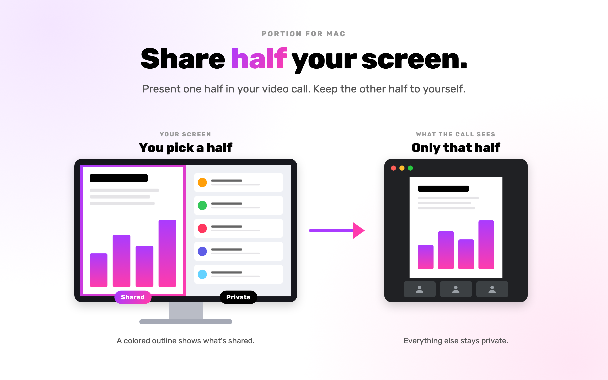
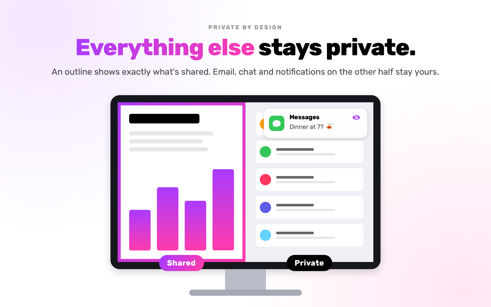

# Submitting Portion to the Mac App Store

This folder has everything you need for the App Store, plus step-by-step instructions. The code side is already done: Portion is sandboxed, has a privacy manifest, and `./build.sh appstore` builds an upload-ready package.

**What's in this folder**

| File | What it's for |
| --- | --- |
| [`metadata.md`](metadata.md) | Every text field for App Store Connect: name, subtitle, description, keywords, review notes, privacy answers. Copy and paste from here. |
| [`screenshots/`](screenshots/) | Five 2880 × 1800 screenshots, ready to upload. |
| [`icon-1024.png`](icon-1024.png) | The app icon at full size, for your website or press. App Store Connect takes the icon from the app itself. |
| [`../PRIVACY.md`](../PRIVACY.md) | Your privacy policy. Apple requires a public link to one. |
| `check-metadata.py` | Re-checks the text in `metadata.md` against Apple's character limits after edits. |

<p align="center">
  
  
</p>

---

## The steps at a glance

1. Join the Apple Developer Program
2. Install Xcode and Transporter
3. Create your two signing certificates
4. Register Portion's App ID and download a provisioning profile
5. Create Portion in App Store Connect
6. Build and upload
7. Fill in the listing and submit for review

You do steps 1–5 once. After that, each update is just step 6 and a short step 7.

---

### 1. Join the Apple Developer Program

Sign up at [developer.apple.com/programs](https://developer.apple.com/programs/) ($99 per year). Approval can take a day or two.

Once you're in, find your **Team ID**: go to [developer.apple.com/account](https://developer.apple.com/account) → **Membership details**. It's 10 letters and numbers, like `A1B2C3D4E5`. You'll need it in step 6.

### 2. Install Xcode and Transporter

Both are free on the Mac App Store:

- **Xcode.** Apple only accepts apps built with Xcode installed. You won't need to open it for anything except step 3.
- **Transporter.** Uploads your finished app to Apple.

After Xcode installs, open **Terminal** (or VS Code's terminal) and run this once:

```bash
sudo xcode-select -s /Applications/Xcode.app
```

It asks for your Mac password, the one you use to log in.

### 3. Create your two signing certificates

These prove the app comes from you.

1. Open **Xcode → Settings… → Accounts**.
2. Click **+** and sign in with your Apple Developer account.
3. Select your team, then click **Manage Certificates…**.
4. Click **+** and choose **Apple Distribution**.
5. Click **+** again and choose **Mac Installer Distribution**.

Both now appear in your keychain. You can close Xcode.

### 4. Register Portion's App ID and download a provisioning profile

**Register the App ID**

1. Go to [developer.apple.com/account/resources/identifiers](https://developer.apple.com/account/resources/identifiers/list) and click **+**.
2. Choose **App IDs** → **App**.
3. **Description:** Portion. **Bundle ID:** choose **Explicit** and enter `com.christopherrose.Portion`.
4. Don't turn on any capabilities. Click **Continue**, then **Register**.

**Download the profile**

1. Go to [Profiles](https://developer.apple.com/account/resources/profiles/list) and click **+**.
2. Under **Distribution**, choose **Mac App Store Connect**.
3. Pick the **Portion** App ID, then your **Apple Distribution** certificate.
4. Name it `Portion App Store` and click **Generate**, then **Download**.

The file lands in Downloads as something like `Portion_App_Store.provisionprofile`.

### 5. Create Portion in App Store Connect

1. Go to [appstoreconnect.apple.com](https://appstoreconnect.apple.com) → **Apps** → **+** → **New App**.
2. **Platform:** macOS. **Name:** Portion. **Primary language:** English (U.S.).
   **Bundle ID:** com.christopherrose.Portion. **SKU:** portion-mac.
3. If "Portion" is taken, see `metadata.md` for alternative names.

### 6. Build and upload

In VS Code's terminal (**Terminal → New Terminal**), run this. Replace the Team ID and file name with yours:

```bash
TEAM_ID=A1B2C3D4E5 APP_STORE_PROFILE=~/Downloads/Portion_App_Store.provisionprofile ./build.sh appstore
```

It takes about a minute and ends with **`Done: dist/Portion-1.0.0.pkg`**. If something is missing, the script says exactly which step to revisit.

Then upload it:

1. Open **Transporter** and sign in with your Apple ID.
2. Drag **`dist/Portion-1.0.0.pkg`** into the window.
3. Click **Deliver**.

After 5–30 minutes, the build appears in App Store Connect, and Apple emails you if anything's wrong with it.

### 7. Fill in the listing and submit

In App Store Connect, open **Portion**:

1. **App Store tab → macOS App.** Paste in the promotional text, description, keywords, support URL, and marketing URL from [`metadata.md`](metadata.md). Upload the five screenshots in order.
2. **Build.** Click **+** and choose the build you uploaded.
3. **App Review Information.** Add your contact details, and paste the reviewer notes from `metadata.md`. No sign-in is needed.
4. **App Information.** Set the category (Productivity), the content rights, and the age rating (answer None/No to everything). Add the **Privacy Policy URL**.
5. **App Privacy.** Answer **No, we don't collect data**.
6. **Pricing and Availability.** Choose a price and the countries.
7. Click **Add for Review**, then **Submit**.

Review usually takes 1–3 days. Apple emails you either way. If they have questions, they appear in App Store Connect under **App Review**.

---

## Before you submit: things to do once

- **Publish your privacy policy and support page.** Apple requires public links, and the GitHub repo is private. Add pages to christopherrose.com:
  - `https://christopherrose.com/portion/privacy`: the text of [`PRIVACY.md`](../PRIVACY.md)
  - `https://christopherrose.com/portion`: what Portion does, plus how to reach you
  If you use different addresses, update them in `metadata.md` too.
- **Add a contact email** to the privacy policy and support page. Apple expects people to be able to reach you.
- **Test the sandboxed app yourself.** Run `./build.sh`, install the DMG, and try sharing in Zoom and Meet. Since this release, every build is sandboxed like the App Store version, so what works for you will work for reviewers. Because the bundle ID changed to `com.christopherrose.Portion`, macOS will ask for Screen Recording permission one more time.

## Releasing an update

Raise the version and the build number, then repeat steps 6 and 7. Apple requires a higher build number for every upload, even a re-upload of the same version.

```bash
VERSION=1.1.0 BUILD=2 TEAM_ID=A1B2C3D4E5 APP_STORE_PROFILE=~/Downloads/Portion_App_Store.provisionprofile ./build.sh appstore
```

In App Store Connect, click **+** next to **macOS App** to add the new version, fill in **What's New**, choose the new build, and submit.

## Changing the graphics or text

- **Screenshots and README pictures:** edit `Scripts/make-graphics.swift`, then run the command at the top of that file.
- **Listing text:** edit `metadata.md`, then run `python3 AppStore/check-metadata.py` to check the length limits.
