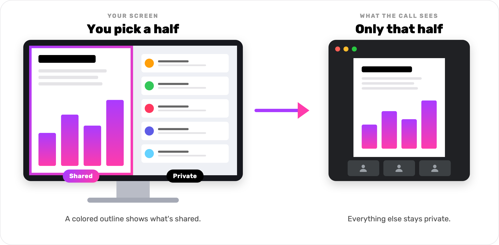
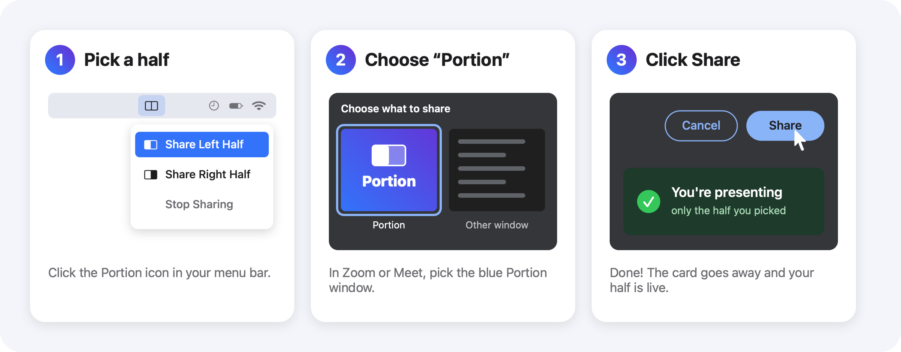
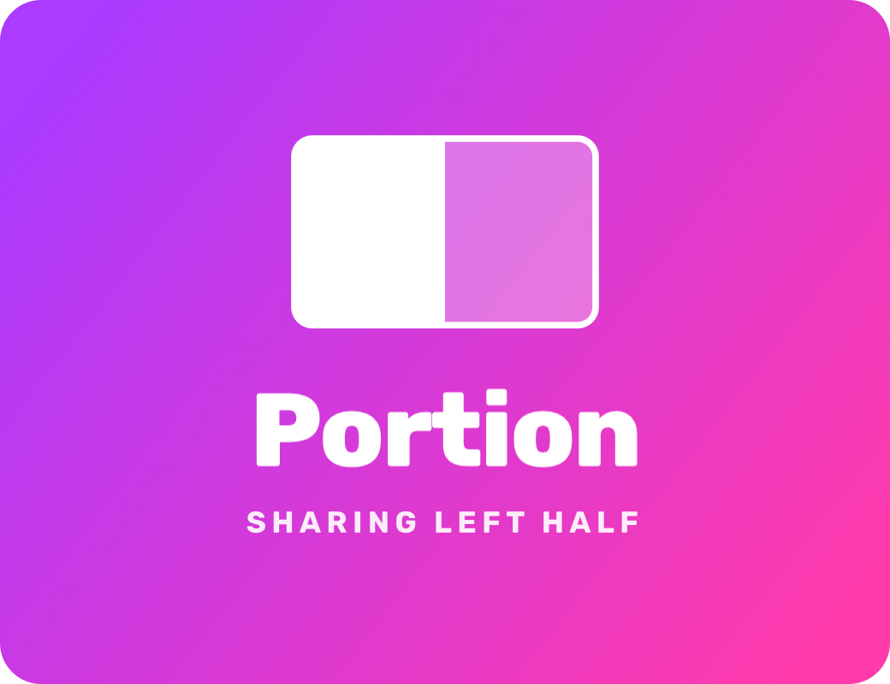
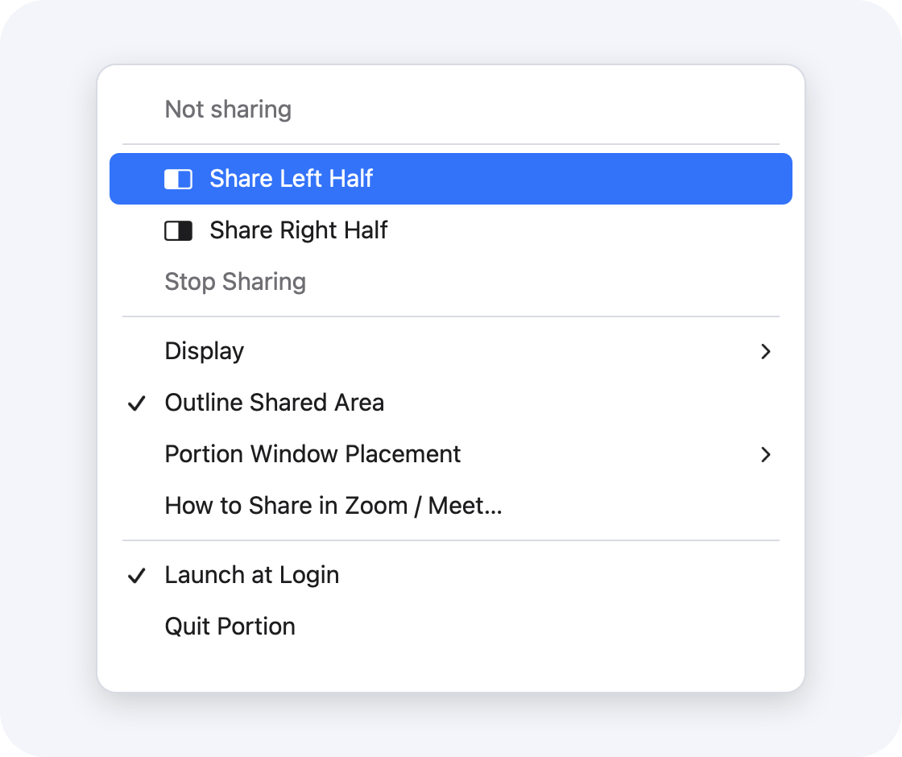

# Portion

**Share just half of your screen in Zoom, Google Meet, and other video calls.**

Show people your slides, document, or demo, and keep your email, chat, and notes on the other half to yourself.

  

---

## Install

1. Open the **Portion .dmg** file.
2. Drag **Portion** into your **Applications** folder.
3. Open Portion from Applications. A welcome message shows you where to find it: a small icon in your menu bar at the top of the screen. Portion has no regular window. It lives up there.

> **"Portion can't be opened"?** Right-click Portion in Applications, choose **Open**, then click **Open** again. You only need to do this once.

### Give Portion permission to see your screen

The first time you use Portion, your Mac asks for permission to record your screen. Portion needs this to copy half of your screen into your call.

1. Click **Open System Settings** when asked. If you missed the prompt, open **System Settings → Privacy & Security → Screen & System Audio Recording**.
2. Turn on **Portion**.
3. **Quit Portion and open it again.** It only notices the new permission after a restart.

Zoom and Chrome need the same permission to share windows. If you've shared your screen in them before, they already have it.

---

## Share half your screen

  

**1. Join your call.** When a Zoom meeting or Google Meet call opens, Portion starts sharing the **left half** of your screen on its own. A purple-and-pink outline appears around that half, so you always know what people can see. The outline is only on your screen. People in the call don't see it.

Want the right half, or using another call app? Click the Portion icon in the menu bar and choose **Share Left Half** or **Share Right Half** yourself.

**2. Share the "Portion" window in your call.**

| App | What to click |
| --- | --- |
| **Google Meet** (Chrome) | **Present now** → **A window** tab → **Portion** → **Share** |
| **Zoom** | **Share Screen** → **Portion** → **Share** |
| **Other apps** | Choose to share a *window* (not your entire screen) and pick **Portion** |

**3. That's it.** Anything you put on that half of your screen is now visible in the call.

### Look for the Portion card

In the list of windows, Portion shows up as this card, so you can find it right away:

  

In Meet and Zoom, the card disappears as soon as you click **Share**, and your screen appears in its place. If you click **Cancel** instead, the card stays up for your next try. In other apps, it disappears on its own after a minute.

### Switch halves during a call

Pick the other half from the Portion menu at any time. The call keeps going, and you don't need to share again.

### Stop sharing

Stop presenting in your call as usual. When you leave or close the Zoom meeting or Meet call, Portion stops on its own a few seconds later. To stop it sooner, choose **Stop Sharing** in the Portion menu. It then stays off until your next call.

---

## The Portion menu

  

| Option | What it does |
| --- | --- |
| **Share Left Half / Share Right Half** | Starts sharing that half, or switches to it. |
| **Stop Sharing** | Stops Portion. |
| **Display** | Appears only if you have more than one monitor. Picks which screen to split. |
| **Outline Shared Area** | Shows or hides the outline around the shared half. |
| **Launch at Login** | Starts Portion automatically when you log in. |

---

## Troubleshooting

**Portion keeps saying it needs Screen Recording permission, even though it's turned on.**
Quit Portion and open it again. If that doesn't help, select **Portion** in **System Settings → Privacy & Security → Screen & System Audio Recording**, remove it with the **–** button, then open Portion and allow it again.

**I don't see Portion in Zoom's or Meet's list of windows.**
The Portion window only exists while Portion is sharing. Portion starts on its own for Zoom meetings and Google Meet calls. For other apps, choose **Share Left Half** or **Share Right Half** *first*. If the list was already open, close it and open it again.

**People in the call see the Portion card instead of my screen.**
The card goes away as soon as Meet or Zoom starts sharing. In other apps, it can take up to a minute to disappear on its own.

**Will people see my notifications, email, or other windows?**
Only if they're on the half you're sharing. Anything on the other half, or on another monitor, stays private.

**Does the call see my mouse pointer?**
Yes, when it's over the shared half.

---

Portion collects no data. See the [privacy policy](PRIVACY.md). Building Portion from source? See [BUILDING.md](BUILDING.md).
